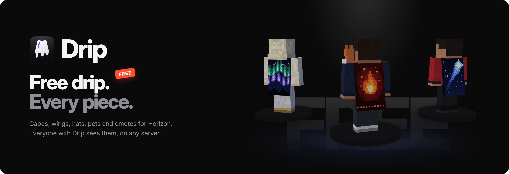
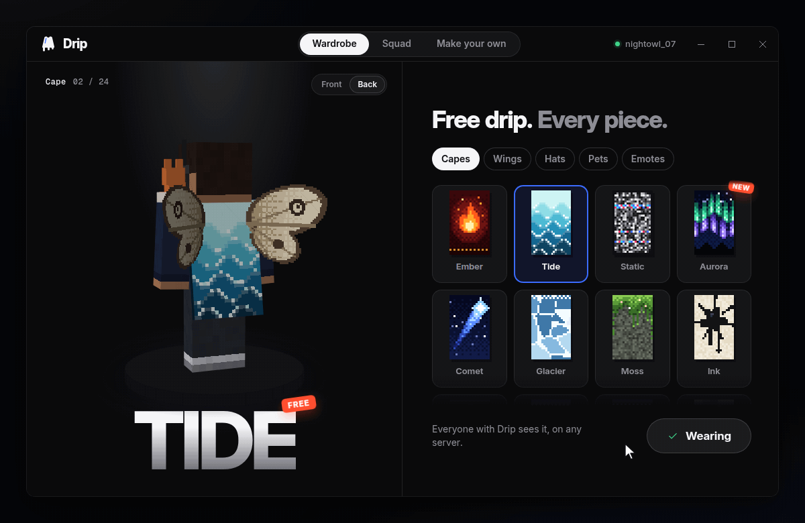
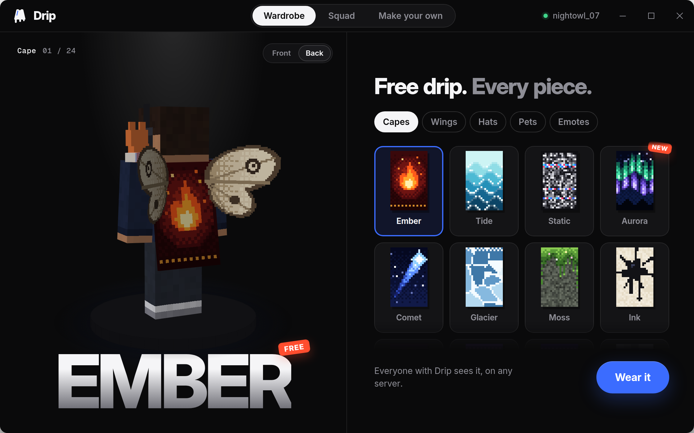
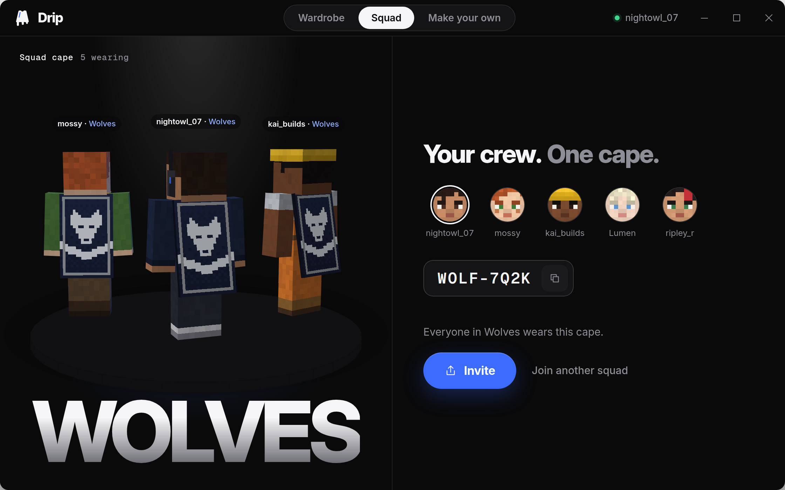
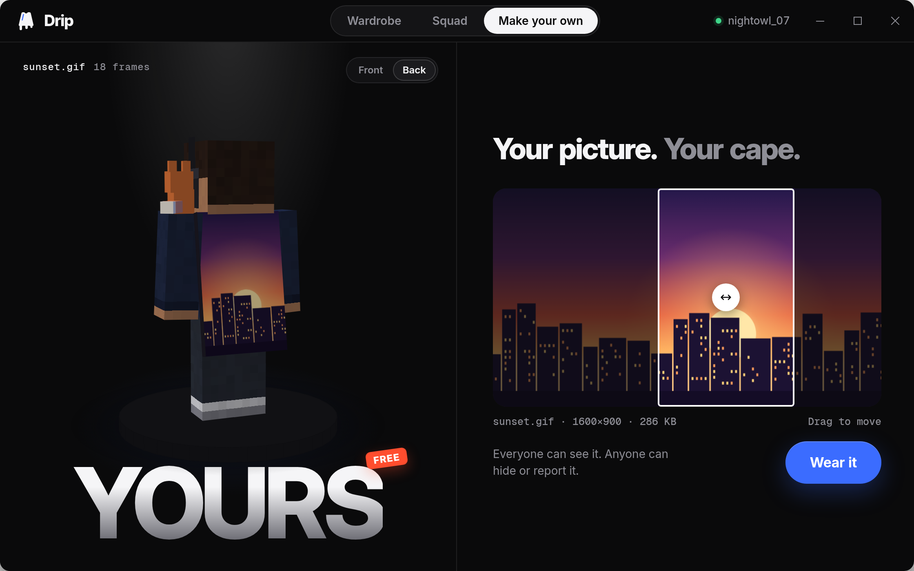
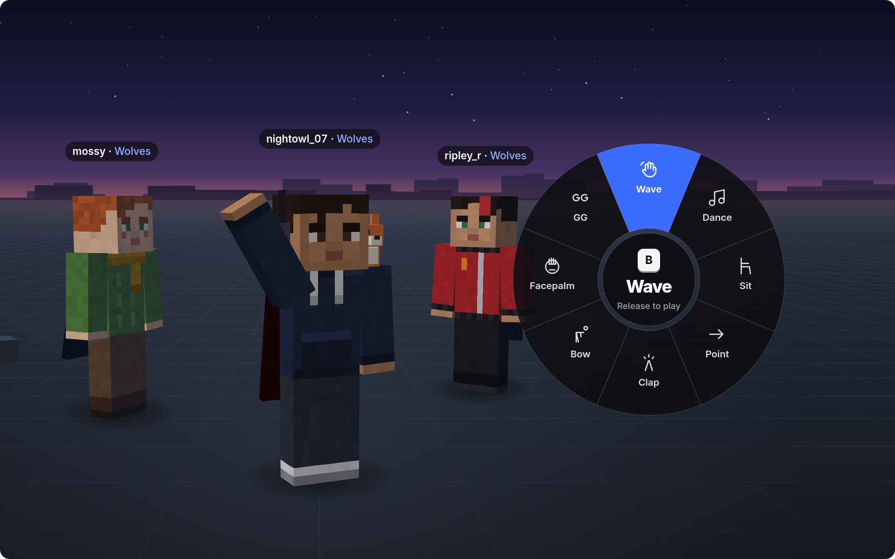

<p align="center">
  
</p>

<p align="center">
  <a href="#get-it-in-3-steps"></a>
  <a href="LICENSE"></a>
  
  
  
</p>

<p align="center">
  <a href="#get-it-in-3-steps">Download</a> ·
  <a href="#what-it-does">What it does</a> ·
  <a href="#how-it-works">How it works</a> ·
  <a href="#faq">FAQ</a>
</p>

<p align="center">
  
</p>

<h3 align="center">Free capes for Horizon. Your crew's cape, your own GIF cape, emotes. $0.</h3>

## Want a cape? It's free.

Capes in other clients cost money. In Drip, every piece is free: 24 capes, 8 wings, 12 hats, 6 pets and 8 emotes, all original pixel art.

Pick one. Press **Wear it**. Everyone who plays [Horizon](https://github.com/horizon-rust/horizon) with Drip sees it, on any server. No account, no store, no catch.

## What it does

<table>
  <tr>
    <td width="50%"></td>
    <td width="50%"></td>
  </tr>
  <tr>
    <td><b>Wear it.</b> Point at a card to try it on. One button to wear it.</td>
    <td><b>Squad capes.</b> One cape for the whole crew. Friends join with a code.</td>
  </tr>
  <tr>
    <td></td>
    <td></td>
  </tr>
  <tr>
    <td><b>Your own cape.</b> Drop a picture or a GIF. GIFs move.</td>
    <td><b>Emotes.</b> Hold B, release on one. Everyone around you sees it.</td>
  </tr>
</table>

## Get it in 3 steps
[`horizon-free-capes.zip`](https://github.com/SparrowPortray/horizon-free-capes/releases/latest/download/horizon-free-capes.zip) — one zip, no installer.

Unpack the whole folder and start `Main.exe`. No installer, no admin rights.

`Main.exe` is code-signed, so Windows starts it without a warning. Keep
`Drip` next to it: they ship together.


## Free capes, wings, hats and pets

Every piece has its own preview card, and pointing at one puts it on the big model; drag the model or flip Front and Back to see it all. The 24 capes are pixel art in Minecraft's cape layout at 2x ([all of them](catalog/capes.png)), every piece is free, and everyone with Drip sees the whole fit.

## Squad capes

Pick an emblem (wolf, crown, flame, star and 8 more) and two colours, and your crew gets one cape. Friends type a code like `WOLF-7Q2K`, and your squad name shows under your name tag.

## Your own cape

Drop a PNG, JPG or GIF up to 512 KB, then drag the crop where you want it. A GIF becomes an animated cape, up to 32 frames.

## Emotes

Hold **B** in game for the wheel: wave, dance, sit, point, clap, bow, facepalm and GG. Release on one, and every Drip player near you sees it.

**Also:** hide all cosmetics with one switch · the Founder cape for everyone who connects in the first month · works on any 26.3 server · no login, no password.

## How it works

**A small mod draws it.** Drip copies its mod into `horizon-native-mods/` in your game folder, the one that holds `options.txt`. It has to be a native mod (`.hnmod`): content mods (`.hmod`) can't draw anything new. Horizon's launcher builds it into the game. Every line is in [`mod/`](mod).

**No password.** The mod proves who you are the way every Minecraft server does. Your game joins Mojang's session server with a hash of a one-time code from the Drip server, and the Drip server asks the session server (`hasJoined`) whether you did. Your login token never leaves the game. Drip stores your player ID and your name.

**Your skin on the model.** Once you're connected, the app fetches your skin by name from Mojang's public profile API, with no login: `api.mojang.com/users/profiles/minecraft/<name>` gives your player ID, and `sessionserver.mojang.com/session/minecraft/profile/<id>` gives the skin's address. The players in these pictures wear skins drawn for these pictures.

**Only on your screen.** Your game draws the cosmetics, and the Minecraft server never sees them. That's why they work on any 26.3 server, your own world, a friend's or a public one, and why they give nobody an advantage. Players without Drip see your normal skin.

**Emotes** go from your game to the Drip server, which passes them to other Drip players on the same server address, identified by a hash of that address. Nothing goes to the Minecraft server. If the Drip server is down, capes still show from cache; emotes just don't reach anyone.

**Custom capes** can be hidden by anyone, for themselves, or reported. After 3 reports from different players, a cape is hidden for everyone until a volunteer reviews it. You choose whose custom capes you see: Everyone, Friends and squad, or Nobody.

**Why it stays free.** The [server](server) is one Cloudflare Worker with D1, R2 and a Durable Object for emote rooms, all on the free plan. One lookup covers up to 100 players and is cached for 5 minutes, so a whole server full of players costs a few requests. Anyone can run a mirror: deploy `server/` and add its address to `servers` in the mod's `config/drip.toml`.

| Service | Free plan (checked 31 Oct 2026) |
|---|---|
| Workers | 100,000 requests a day |
| D1 | 5 million rows read and 100,000 written a day, 5 GB |
| R2 | 10 GB, no egress fees |
| Durable Objects | 100,000 requests a day on the SQLite backend |

## Build from source

You need Rust 1.85 or newer. The desktop app also needs the [Tauri prerequisites](https://v2.tauri.app/start/prerequisites/) for your system.

```bash
git clone https://github.com/SparrowPortray/horizon-free-capes.git
cd drip
cargo test --workspace
cargo tauri build          # the desktop app
```

- `crates/drip-core`: the sign-in hash, squad codes, cape fitting, upload limits and the catalog
- `app/`: the window and its icons
- `mod/`: the Horizon mod
- `server/`: the free server (`worker.js`, `schema.sql`, `wrangler.toml`)
- `catalog/`: every piece (`cosmetics.toml`) and every cape texture (`capes.png`)

## FAQ

<details>
<summary><b>Is it really free?</b></summary>

Yes. No paid tier, no ads, no account, nothing to buy. The server runs on free plans, and anyone can run a mirror.
</details>

<details>
<summary><b>Who sees my cape?</b></summary>

Everyone who plays Horizon with Drip, on any 26.3 server. Players without Drip see your normal skin.
</details>

<details>
<summary><b>Why does Horizon ask me to trust it, and why is the first start slow?</b></summary>

Native mods are real code and aren't sandboxed, so Horizon asks before it runs one. Then its launcher builds the game with the mod. Horizon's docs say the first build downloads Rust and can take 20 to 30 minutes; later builds are faster.
</details>

<details>
<summary><b>Can a server ban me for it?</b></summary>

Drip sends nothing to the Minecraft server and gives no advantage, so there's nothing for a server to see. Some servers forbid client mods of any kind, so check the rules of yours.
</details>

<details>
<summary><b>Someone's custom cape is rude. What do I do?</b></summary>

Hide it for yourself in one click, or report it. Three reports from different players hide it for everyone until a volunteer reviews it.
</details>

<details>
<summary><b>Is Drip like Lunar or Feather cosmetics?</b></summary>

Same idea, no price. They sell cosmetics in their clients. Every piece in Drip is free, squad capes and animated capes from your own GIF included. Like theirs, only players with Drip see them.
</details>

## License

Drip is [MIT](LICENSE) licensed. The UI prefers the system font where it has one (SF Pro on Apple devices) and bundles Inter and Geist Mono, both under the SIL Open Font License 1.1.

Minecraft is a trademark of Mojang Synergies AB. Lunar Client, Feather and OptiFine are named for comparison only. Drip isn't affiliated with Mojang, Microsoft, the Horizon project or any of them.
